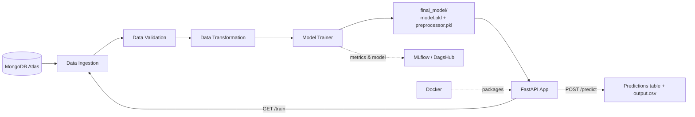

# 🛡️ Network Security – Phishing Website Detection

An end-to-end machine learning project that classifies a website as **legitimate** or **phishing** using 30 URL and website features. It covers the full workflow: data ingestion from MongoDB, validation, transformation, model training with experiment tracking, a FastAPI prediction service and Docker packaging.

---

## 📌 Overview

| Item | Details |
|------|---------|
| **Problem** | Binary classification: phishing vs. legitimate website |
| **Dataset** | `Network_Data/phisingData.csv` – 11,055 rows, 30 features + target `Result` |
| **Target** | `Result`: `1` = legitimate, `-1` = phishing |
| **Models compared** | Random Forest, Decision Tree, Gradient Boosting, Logistic Regression, AdaBoost (with hyperparameter tuning) |
| **Serving** | FastAPI (`/train`, `/predict`) |
| **Tracking** | MLflow (DagsHub) |
| **Deployment** | Docker (optional AWS deployment, see below) |

**Example features:** `having_IP_Address`, `URL_Length`, `Shortining_Service`, `SSLfinal_State`, `Domain_registeration_length`, `web_traffic`, `Page_Rank`, `Google_Index`, and more (full list in `data_schema/schema.yaml`).

---

## 🏗️ Architecture



### Pipeline stages

| # | Stage | What it does | Output (inside `Artifacts/<timestamp>/`) |
|---|-------|--------------|------------------------------------------|
| 1 | **Data Ingestion** | Reads the collection from MongoDB, saves it as a feature store CSV and splits it into train/test (80/20) | `data_ingestion/feature_store/`, `data_ingestion/ingested/train.csv`, `test.csv` |
| 2 | **Data Validation** | Checks the column count against `schema.yaml` and runs a drift check (KS test, p-value threshold 0.05) between train and test | `data_validation/validated/`, `data_validation/drift_report/report.yaml` |
| 3 | **Data Transformation** | Fills missing values with a KNN Imputer (`n_neighbors=3`) and saves the preprocessor | `data_transformation/transformed/train.npy`, `test.npy`, `transformed_object/preprocessing.pkl` |
| 4 | **Model Training** | Trains and tunes 5 models with GridSearch, picks the best by test score, logs F1, precision and recall to MLflow, and saves the model | `final_model/model.pkl`, `final_model/preprocessor.pkl` |

After training, `TrainingPipeline` can sync artifacts and the final model to an S3 bucket.

---

## 📁 Project Structure

```
networksecurity/
├── networksecurity/
│   ├── components/        # data_ingestion, data_validation, data_transformation, model_trainer
│   ├── pipeline/          # training_pipeline.py, batch_prediction.py
│   ├── entity/            # config_entity.py, artifact_entity.py
│   ├── constant/          # pipeline constants
│   ├── utils/             # main_utils (save/load), ml_utils (metrics, NetworkModel)
│   ├── cloud/             # s3_syncer.py
│   ├── exception/         # custom exception handling
│   └── logging/           # logger setup
├── Network_Data/          # raw phishing dataset (CSV)
├── data_schema/           # schema.yaml (expected columns)
├── templates/             # table.html (prediction output page)
├── final_model/           # trained model + preprocessor
├── valid_data/            # sample CSV for testing /predict
├── prediction_output/     # output.csv from /predict
├── app.py                 # FastAPI application
├── main.py                # run the training pipeline from the terminal
├── push_data.py           # load the CSV into MongoDB
├── Dockerfile
├── requirements.txt
└── setup.py
```

---

## 🧰 Tech Stack

Python · pandas · NumPy · scikit-learn · SciPy · MongoDB (PyMongo) · FastAPI · Uvicorn · Jinja2 · MLflow · DagsHub · Docker · AWS S3 (optional)

---

## 🚀 How to Run

### 1. Clone and install
```bash
git clone <your-repo-url>
cd networksecurity
python -m venv venv
venv\Scripts\activate          # Mac/Linux: source venv/bin/activate
pip install -r requirements.txt
```

### 2. Run predictions only (no database needed)
The trained model is included in `final_model/`.
```bash
python app.py
```
Open **http://localhost:8000/docs** → **POST /predict** → **Try it out** → upload `valid_data/test.csv` → **Execute**.

> If you get a pickle or version error, install `scikit-learn==1.5.2`.
> If `/predict` returns a template error on a newer FastAPI version, change the line in `app.py` to
> `templates.TemplateResponse(request, "table.html", {"table": table_html})`.

### 3. Run the full training pipeline (needs MongoDB)
Create a `.env` file in the project root:
```
MONGODB_URL_KEY=<your MongoDB Atlas connection string>
```
Then:
```bash
python push_data.py     # load the CSV into MongoDB
python main.py          # ingestion → validation → transformation → training
```
Or start the API and call `GET /train`.

### 4. MLflow / DagsHub
Set your **own** DagsHub repository URI and credentials for MLflow tracking in `networksecurity/components/model_trainer.py`. Use environment variables rather than hardcoding secrets.

---

## 🔌 API Endpoints

| Method | Endpoint | Description |
|--------|----------|-------------|
| GET | `/` | Redirects to the Swagger docs (`/docs`) |
| GET | `/train` | Runs the full training pipeline |
| POST | `/predict` | Upload a CSV of features and get predictions |

---

## 📤 Output

`POST /predict` returns an HTML table of the uploaded data with an extra **`predicted_column`**, and saves it to `prediction_output/output.csv`.

| predicted_column | Meaning |
|------------------|---------|
| `1` | Legitimate website |
| `-1` | Phishing website |

---

## 🐳 Docker

```bash
docker build -t networksecurity .
docker run -p 8000:8000 --env-file .env networksecurity
```

---

## ☁️ Cloud Deployment (Optional)

Deployment to AWS is **not required** to run this project. If you want to deploy it later, the Docker image can be pushed to **AWS ECR** and run on **EC2**, with a GitHub Actions workflow to automate it. This needs an AWS account, an ECR repository and an EC2 instance, plus these GitHub secrets: `AWS_ACCESS_KEY_ID`, `AWS_SECRET_ACCESS_KEY`, `AWS_REGION`, `AWS_ECR_LOGIN_URI`, `ECR_REPOSITORY_NAME`.

---

## 🔮 Possible Improvements
- Add unit tests and a CI/CD pipeline (GitHub Actions → AWS)
- Move all credentials and URIs to environment variables
- Add model evaluation plots (confusion matrix, ROC curve) to the README
- Add a simple front-end for single-URL checks

---

## 👤 Author

**Mohamed Kaif K.S** 
GitHub: [Kaif-077](https://github.com/Kaif-077)
